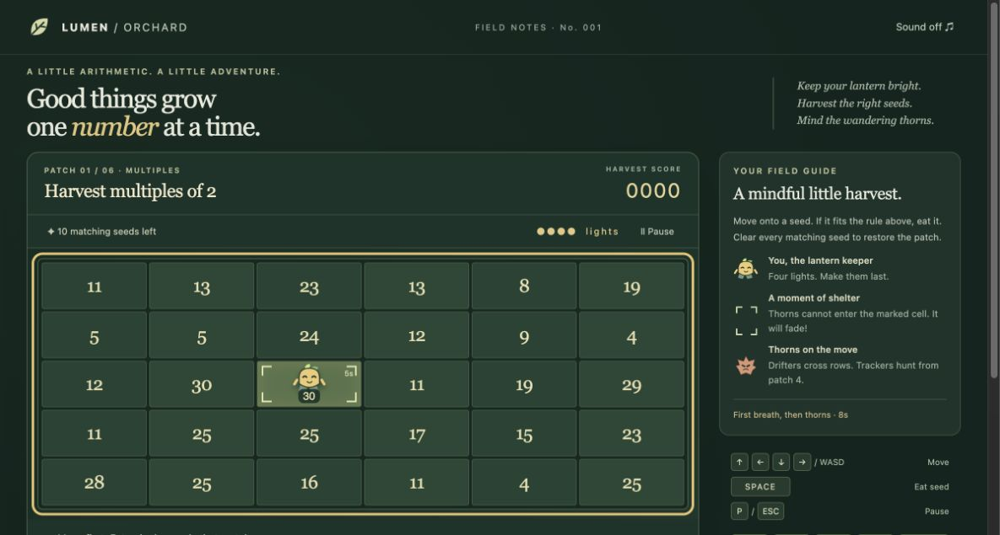

# Lumen Orchard

A little arithmetic, a little adventure. Guide a lantern keeper through a fixed mathematical garden, harvest matching seeds, and avoid wandering thorns.

An original browser game closely inspired by the characteristic **Number Munchers** loop: a six-column, five-row board, directional movement, separate eating input, a rule above the board, wrong-answer consequences, roaming enemies, temporary shelters and clearing every matching answer. All game code, character art, names, styling and optional synthesized tones are original. No original-game assets or code are included. Not affiliated with MECC or its successors.



## Play locally

Node.js 24 recommended.

```sh
npm ci
npm run build
npm run preview -- --port 5222
```

Open http://127.0.0.1:5222. Use another free port if this one is occupied. The delivered Mac preview runs detached on **5222** bound to loopback only; no public website is deployed.

```sh
npm run dev -- --port 5223
npm run typecheck
npm test
npm run build
```

## Controls

| Action | Input |
| --- | --- |
| Move one cell | Arrow keys or WASD |
| Eat current cell | Space |
| Pause / resume | P or Escape, or Pause button |
| Start / recover / next patch | Enter or overlay button |
| Start over | Choose category, then New run |
| Touch / pointer | Direction buttons and Eat; cells are not answer buttons |
| Sound | Sound toggle, off by default |

Eating is explicit: walking over a seed never eats it. Eat all ten matching seeds to clear each patch; leave the distractors. A run has six patches and four lives. Wrong answers and thorn contact each cost a life. After an error, read the explanation and restore your lantern; a two-second protective glow helps you recover. Empty cells have no penalty. Every correct seed earns five points multiplied by the patch number.

Five categories: **Multiples**, **Factors**, **Primes**, **Equality**, and **Inequality** (expressions **not equal** to a target). Equality/inequality use addition, subtraction, multiplication and exact division. Prime ranges broaden from 1–30 to 1–80. Expression operands can be negative; no JavaScript eval is used.

A Drifter enters after eight active seconds and crosses a row, reversing before a shelter and leaving at the edge. A Tracker joins from patch four after fourteen seconds, taking a shortest available step toward you. Trackers remain on the board. Movement starts at one step per second and speeds up across patches. Shelters last five seconds in a seven-second cycle, relocate, exclude thorns, and remove a thorn if one is underneath when a shelter appears. These timings are original balance choices.

The game pauses on window blur or hidden tab. Your run and personal best are stored automatically under `lumen-orchard.save.v1` on this browser/origin. Reload resumes active play paused. Saves include board, position, enemies, clocks, score, lives and patch. Invalid saves are discarded; unavailable/full storage allows play with a visible save warning. A new run replaces this game's current run and retains its best. No other game keys are touched. Saves are local, not cloud accounts; changing host/port changes storage origin.

## Gameplay research

Rules were chosen after reading the complete [MECC Apple II v1.x User's Guide](https://archive.org/details/MECC_a-170_number_munchers) (January 1987, June 1991 printing), and cross-checking [Chalkdust's illustrated DOS gameplay account](https://chalkdustmagazine.com/blog/review-number-munchers/) and the [later mobile port description](https://apps.apple.com/ua/app/number-munchers/id341982973). See the detailed [research and fidelity ledger](docs/RESEARCH.md), [settled design](docs/SPEC.md), and [architecture decision](docs/adr/0001-bounded-fidelity.md).

The Apple II manual explicitly defines Inequality as not equal, whereas the DOS account includes a less-than example. We follow the manual. Earlier Apple II keys, DOS arrows and later mobile navigation differ; this game uses modern desktop arrows/WASD and Space. The manual describes five enemy roles but does not give exact spawn/movement/shelter timings. We do not claim frame accuracy.

This is a bounded slice: two original enemy roles, six patches, free pause, explicit recovery and local saves. It omits board-rewriting enemies, helpers, workers, bashful behavior, enemy cannibalism, extra lives, original scoring curve, cartoons, teacher controls, challenge mix and infinite levels. See [QA evidence and known limits](docs/QA.md).

## Engineering

Strict TypeScript + Vite; no runtime dependencies, network requests, trackers or remote fonts. Pure game simulation (`src/game.ts`), mathematical rules/generation (`src/math.ts`), validated versioned persistence (`src/save.ts`) and DOM/audio adapter (`src/main.ts`). CI runs install, strict types, behavioral tests and production build on every push. The `.gitignore` includes the official GitHub Global Linux, Windows and macOS templates, plus project ignores. Templates retrieved from [github/gitignore](https://github.com/github/gitignore/tree/main/Global).

MIT licensed; see [LICENSE](LICENSE).

## Play online

[Play on GitHub Pages](https://intrepion.github.io/kata-inspired-by-number-munchers-codex-dot/). Return to the [Kata Arcade](https://intrepion.github.io/).
